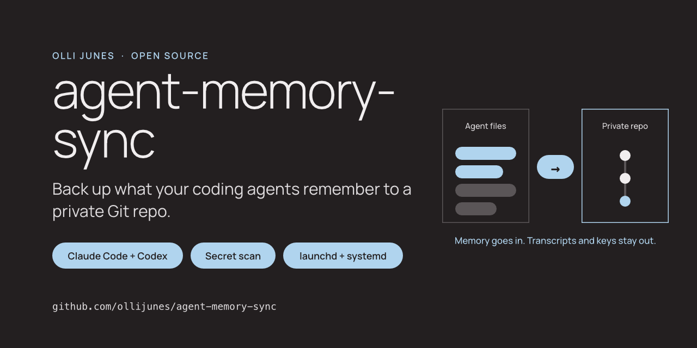

# agent-memory-sync



[](https://github.com/ollijunes/agent-memory-sync/actions/workflows/ci.yml)
[](pyproject.toml)
[](LICENSE)

Back up Claude Code and Codex memory and instruction files to a private Git
repository on a schedule, with a secret scan before every commit.

Claude Code writes what it learns about you and your projects into memory
files. You write instructions in `CLAUDE.md` and `AGENTS.md`. None of this is
in a Git repository by default, and a new laptop or a deleted folder loses
it. Session transcripts, by contrast, are large and often contain pasted
secrets, so backing up all of `~/.claude` is the wrong fix.

agent-memory-sync copies only an allowlist of memory, instruction and config
files into a separate Git repository you own. It scans the copies with
[Gitleaks](https://github.com/gitleaks/gitleaks) and a built-in scanner, and
commits only when both are clean. launchd or a systemd timer runs it every
day.

[Restore](docs/restore.md) · [What is copied](docs/what-is-copied.md) ·
[Security](SECURITY.md) · [Contributing](CONTRIBUTING.md) ·
[ollijunes.com](https://ollijunes.com)

## Who it is for

People who use Claude Code, Codex CLI or both on macOS or Linux and want
their agents' memory to survive a lost machine, without putting transcripts
or keys into Git.

## Install

You need Python 3.11+, Git and Gitleaks.

```sh
brew install gitleaks          # or see the Gitleaks releases page
uv tool install git+https://github.com/ollijunes/agent-memory-sync
agent-memory-sync --version
```

`pipx install git+https://github.com/ollijunes/agent-memory-sync` works too.

## Set up

Create an empty private repository on GitHub or any Git host first. Then:

```sh
agent-memory-sync init \
  --repo ~/backups/agent-memory \
  --machine laptop \
  --remote https://github.com/YOUR-NAME/agent-memory.git
agent-memory-sync doctor
```

`--machine` is a short label of your choice. Each machine gets its own
folder, so several machines can share one backup repository. The config goes
to `~/.config/agent-memory-sync/config.toml`. If the remote is on GitHub and
the `gh` CLI is installed, `init` and `doctor` warn when the repository is
public.

See what would be copied, without touching the repository:

```sh
agent-memory-sync plan
```

```text
include claude/CLAUDE.md
include claude/projects/-home-alex-src-demo/memory/MEMORY.md
include codex/AGENTS.md
include codex/config.toml
skip claude/.credentials.json: excluded:**/.credentials.json
skip claude/projects/-home-alex-src-demo/transcript.jsonl: excluded:**/*.jsonl
skip claude/projects/-tmp-demo/memory/MEMORY.md: excluded:projects/-tmp-*/**
skip codex/auth.json: excluded:**/auth.json
```

Run the first backup:

```sh
agent-memory-sync run
```

```text
copied=5 unchanged=0 removed=0 skipped=... commit=d7e0b7c...
```

The output above comes from the synthetic home folder in
[`examples/home`](examples/home).

## Schedule

```sh
agent-memory-sync schedule install --at 02:00
```

On macOS this writes a launchd agent to `~/Library/LaunchAgents/` and loads
it. A run missed while the Mac sleeps happens at the next wake. macOS shows a
"Background item added" notice the first time. Logs go to
`~/Library/Logs/agent-memory-sync/`.

On Linux it writes a systemd user service and timer to
`~/.config/systemd/user/` and enables the timer. `Persistent=true` catches up
a missed run at the next login. The timer runs only while you are logged in,
unless you enable lingering with `loginctl enable-linger`. Logs:
`journalctl --user -u agent-memory-sync.service`.

`schedule print` shows the files without installing them. `schedule
uninstall` removes them. The same templates are in [`contrib/`](contrib) if
you prefer to install by hand.

The scheduled job pushes with your normal Git credentials. On macOS the
launchd agent runs in your login session, so the Keychain and your SSH agent
work. On Linux an SSH agent is usually not available to a timer; use a deploy
key or a credential helper.

## When a run stops

| Exit | Meaning | What to do |
| --- | --- | --- |
| 0 | Done, or no changes | Nothing |
| 3 | Possible secret found | The output names the file, line and rule, never the value. Remove the secret from the source file, or allowlist a false positive (see below) |
| 4 | Uncommitted changes in the backup folder | Look at `git status` in the backup repository and commit or discard them |
| 5 | No Git identity in the backup repository | Set `git config user.name` and `user.email` there |
| 6 | Push failed | The commit is kept and the next run pushes it. Check the remote and your credentials |
| 7 | Gitleaks is not installed | Install it, or opt in to `scanner = "builtin"` in the config |

When a secret is found, nothing is written to the backup repository.

False positives are common in memory files, because they are prose that
mentions tokens and keys. For Gitleaks, add an allowlist to `.gitleaks.toml`
in the backup repository. For the built-in scanner, end the line with
`# agent-memory-sync: allow` or `<!-- agent-memory-sync: allow -->`. The tool
never adds allowlist entries by itself.

## Configuration

```toml
repo = "~/backups/agent-memory"
machine = "laptop"
push = true
scanner = "gitleaks"          # or "builtin"
max_file_bytes = 1048576

[sources.claude]
enabled = true
include = []                  # extra globs relative to ~/.claude
exclude = []

[sources.codex]
enabled = true
include = []
exclude = []
```

`CLAUDE_CONFIG_DIR` and `CODEX_HOME` are honoured. Your `include` globs add
files but cannot override a built-in exclusion. [What is
copied](docs/what-is-copied.md) lists every rule.

## Limitations

- The secret scan finds known key formats and obvious assignments. It cannot
  tell that a sentence in a memory file is private. Keep the backup
  repository private and treat it like the files themselves.
- Files are stored as plain text in Git. Your Git host can read them. Use a
  host you trust, or a self-hosted remote.
- Project-level `CLAUDE.md`, `AGENTS.md` and `CLAUDE.local.md` files are not
  copied. They belong to each project's own repository.
- Codex memories stored in SQLite are not copied, only Markdown files under
  `memories/`.
- Any file or folder whose name contains `token`, `secret`, `credential` or
  `password` is skipped, even a harmless one such as a skill called
  `secret-scanner`.
- macOS and Linux only. Windows is not supported.
- The backup is one way. `restore` writes files back only when you ask it to.

## How it compares

Several `claude-code-backup` scripts and [chezmoi](https://www.chezmoi.io)
style dotfile managers can back up the same files. The difference here is a
narrow allowlist for both Claude Code and Codex instead of the whole
folder, a secret scan that blocks the commit, filtering of temporary session
folders, and no cloud service beyond the Git remote you choose.

## Development

```sh
uv sync --locked
uv run python -m pytest --cov=agent_memory_sync --cov-fail-under=90
uv run ruff check .
uv run ruff format --check .
python3 scripts/check_public_tree.py
```

The tests use a synthetic home folder in a temporary directory and never read
your real `~/.claude` or `~/.codex`.

## License

[MIT](LICENSE). Made by [Olli Junes](https://ollijunes.com). Not affiliated with
Anthropic or OpenAI.
